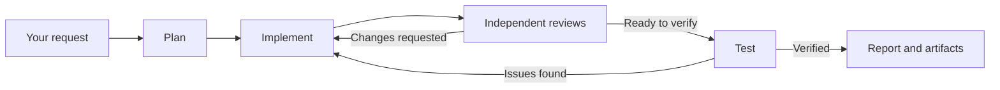

English | [Simplified Chinese](README.zh-CN.md)

# Agent Workbench

**Bring your AI coding CLIs together. Let them plan, build, review, and pass work to one another.**

Agent Workbench is a self-hosted workspace for collaboration between **Codex, Claude Code, Grok Build, and Antigravity**. Give the team a goal, assign responsibilities, and let different CLIs carry the work from planning through implementation, review, and testing.

For example, Claude Code can develop a plan, Codex can implement it, and Grok or Antigravity can review the result. Review feedback goes back to the implementer, who fixes the issues and returns the work for another check. Each role can continue its own conversation while the team moves the task forward.

The CLIs run on your own computers and servers, using their existing tools and login sessions. Workbench coordinates assignments, feedback, code deliveries, and artifacts in one project conversation.

> Development preview (`0.4.0`), intended for a single trusted operator or a small trusted team. Workbench drives native CLIs; model access, billing, and quotas follow each provider's terms. See [current boundaries](#limitations-and-roadmap).

## From individual assistants to a working team

Using several coding assistants often means copying the same requirements into different terminals, forwarding review comments, finding the right code version, and asking who is waiting for whom.

Workbench makes those handoffs part of the project workflow:

- **Take turns on the same task.** Pass a plan to an implementer, send the implementation for review, and return feedback for revision.
- **Split independent work.** Assign separate parts of a project to different roles, subject to device capacity and workspace rules.
- **Review across models.** Ask other roles to inspect an implementation independently, then send the findings back to its author.
- **Keep the next step visible.** Track assignments, pending replies, task records, and execution details in one place.

Address a role directly with `@role`, or ask the project manager to coordinate the work. A role combines a device, CLI, model, reasoning setting, and responsibility. You choose the team and its workflow.

## A typical collaboration

Ask the manager:

> Add a quotation import feature. Agree on a plan, assign implementation, have two other roles review it independently, then test the fixes and report the result. Do not merge or deploy.

The team can work through the following cycle:



| Stage | Example role | What it passes on |
| --- | --- | --- |
| Plan | Claude Code as manager | Scope, acceptance criteria, and assignments |
| Implement | Codex as developer | Code version, changes, and self-check results |
| Review | Grok and Antigravity as reviewers | Independent findings against the assigned version |
| Revise | Original developer | Fixes and responses to review findings |
| Verify and report | Tester and manager | Test evidence, artifacts, and remaining issues |

These are example assignments, not fixed vendor roles. Any supported CLI can take a suitable responsibility. Handoffs carry task instructions, code versions, artifacts, and feedback; the CLIs keep their own native sessions. The manager can coordinate the next step through Workbench's collaboration tools. Merge, deployment, and other production actions require separate explicit authorization.

## What you can do

### Collaborate in a project group chat

Keep requirements, assignments, discussion, and final results together. Use direct mentions, manager coordination, role consultations, or whole-task transfers to decide who works next.

Each group has its own task list with descriptions, steps, owners, status, and change history. Task records describe the work; execution queues and run records show what is actually running or waiting. A successful process exit does not by itself mean the task passed review.

### Continue native conversations

The Sessions view lets you browse and continue supported native CLI conversations. Read replies, expand tool calls on demand, and queue follow-up messages while a reply is running.

Claude and Codex also support side questions for a separate discussion alongside the main flow. History, side-question, and quota capabilities vary by CLI.

### Hand work between your computer and servers

Run planning or interactive work on your computer and assign another role to a server with the required environment. Each execution device has a Worker that drives its installed CLIs and accesses its configured project directories.

Bind the corresponding project folders on participating devices. Use fixed-commit Git deliveries when a reviewer or collaborator needs an exact code version. Optional source synchronization exchanges saved files within explicitly configured scopes, with visible status and conflict records. Synchronization is enabled per project scope; it does not commit, merge, or deploy code. When all participating Workers support bounded transfers, both manual and automatic synchronization split large changes into ordered parts instead of rejecting the project for having more than 10,000 files. File-size, storage, exclusion, and conflict protections still apply.

Cross-device collaboration passes work and its inputs between roles. It does not migrate a vendor's native session to another device.

### Inspect the work and its outputs

Open run details to inspect inputs, CLI output, tool calls, and results. View Markdown reports and file previews in a dialog or side panel. Long history and tool details load on demand.

Bare filenames in replies use explicit file paths from the same turn's tool records when the match is unique. Group-chat history loads those records on a file click; ambiguous names remain unresolved. Completed session replies stay visible while native history catches up, then return to the history view without duplicating the final answer.

Device availability, queues, failures, and supported Token or quota information help you decide where to assign the next task. Usage figures are observations from the CLI environment, not provider billing statements.

### Keep your existing CLI environment

Install and log in to the CLIs on the devices where they will run. Workbench uses those native runtimes and their tool environments. GitHub and Gitee repository hosting are supported.

Shared project rules belong in the project's `AGENTS.md`, with a `CLAUDE.md` pointer where needed. Existing instruction files are preserved when a project is prepared. Role-specific instructions can define how each collaborator contributes.

## Architecture overview

| Component | Responsibility |
| --- | --- |
| **Home** | Serves the web UI, stores project and conversation state, and coordinates queues and assignments |
| **Worker** | Runs on an execution device, discovers its CLIs, executes work, and reports events and results |
| **Native CLI** | Uses its own session, model access, tools, and local project files to perform the assigned work |

A single-machine setup runs Home and Worker together as separate processes. For multiple devices, keep one Home and connect Workers from the other computers or servers over authenticated WebSockets.

The implementation uses JavaScript ES modules, Node.js, SQLite, and a browser/PWA interface with no front-end build step. See the [architecture document](docs/ARCHITECTURE.md) for implementation boundaries.

## Requirements

- Node.js **22.16 or later**. The repository's `.nvmrc` pins a tested version.
- Git.
- At least one supported CLI installed and logged in on each execution device: `codex`, `claude`, `grok`, or `agy`.
- For a collaboration team, configure multiple roles using the CLIs and models available on your devices.
- SSH access is optional and used by the remote-device onboarding helper.

## Quick start (single machine)

```sh
git clone https://github.com/robinli1228-ctrl/workbench.git
cd workbench
nvm use          # optional, if you use nvm
npm ci
npm run dev
```

Open [http://127.0.0.1:4317](http://127.0.0.1:4317). The default listener is local only. `npm run dev` starts Home and Worker as separate processes.

In the UI:

1. Open Settings → Devices and CLIs and check that your device and installed CLIs are detected.
2. Create a project, choose its folder, and select a device, CLI, and model for the manager.
3. Configure the repositories and roles yourself, or ask the manager to propose them and confirm its configuration cards.
4. Give the manager a goal, or `@` a role to start a specific assignment.

To start the processes separately:

```sh
npm start        # Home
npm run worker   # Worker, in another terminal
```

## Configuration

Use [`.env.example`](.env.example) as a reference. Workbench does not automatically load `.env` files; export settings in your shell or service manager.

| Setting | Purpose |
| --- | --- |
| `HOST`, `PORT` | Home listener; defaults to `127.0.0.1:4317` |
| `DATA_DIR` | Home's private data directory |
| `API_TOKEN` | Browser/API access token; required for non-loopback listening |
| `WORKER_TOKEN` | Shared Worker registration credential; must match Home |
| `HOME_URL` | Worker's WebSocket connection to Home |
| `WORKER_ROOTS` | Project directories the Worker may use |
| `WORKER_DATA_DIR` | Private data directory for that Worker |
| `WORKER_CONCURRENCY` | Device execution capacity; defaults to `2` |
| `CODEX_BIN`, `CLAUDE_BIN`, `GROK_BIN`, `AGY_BIN` | Optional paths to CLI executables |

Keep runtime data, credentials, logs, and private validation artifacts out of Git. Do not share one Worker data directory between processes. For remote access, use an SSH tunnel or an HTTPS/WSS reverse proxy; Home does not terminate TLS itself.

The [operating guide](docs/OPERATING-GUIDE.md) covers device onboarding, account configuration, multi-device setup, data handling, and release procedures.

## Limitations and roadmap

- **Trusted operators.** Browsers share Home credentials; there is no per-user identity or enterprise tenant isolation. Managed CLI execution uses automatic approval modes, with no native per-step approval. Workbench is not an OS sandbox for untrusted code.
- **One Home.** Automatic replication and failover are not implemented. An unavailable or sleeping Home cannot dispatch work.
- **CLI differences.** Available models, history, side questions, and quota reporting depend on the CLI and device. Missing information is not evidence of zero usage or a completed task.
- **Explicit file synchronization.** Synchronization must be configured. The optional simple metadata mode supports two devices and retains the Mac display-side requirement; compare its behavior and limits in the [file-sync contract](docs/design-source-sync.md).
- **Concurrent editing.** The project's Concurrent edits switch is off by default. Turning it on does not add file-level locks; roles editing the same files can overwrite one another's changes.
- **Task handoffs, not native-session migration.** Roles can exchange assignments, fixed code versions, and artifacts across devices. Controlled cross-device migration of native sessions remains a [design](docs/design-session-handoff.md).
- **Review and release remain distinct.** A completed run, an accepted review, a merged commit, and a deployed version are separate outcomes. The collaboration workflow does not grant automatic merge or deployment permission.

## Development

```sh
npm ci
npm run check    # JavaScript syntax checks
git diff --check
```

Read [CONTRIBUTING.md](CONTRIBUTING.md) and [AGENTS.md](AGENTS.md) before contributing. Behavior changes also need verification appropriate to the affected flow; syntax checks alone do not establish runtime correctness.

## Documentation

- [Operating guide](docs/OPERATING-GUIDE.md): setup, accounts, devices, and release procedures.
- [Architecture](docs/ARCHITECTURE.md): current components and interface boundaries.
- [Product scope](docs/PRD.md): goals and planned capabilities.
- [Coordination design](docs/design-coordination.md): manager and role collaboration.
- [Review delivery](docs/design-review-delivery.md): fixed-version review inputs.
- [Source synchronization](docs/design-source-sync.md): scope, conflict handling, and current limits.
- [Documentation index](docs/README.md): detailed feature contracts and designs.

## License

[MIT](LICENSE).
